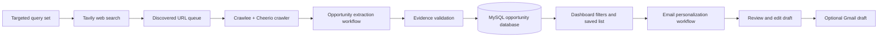

# GradFund Finder

**A research and outreach assistant for finding graduate study opportunities and preparing evidence-grounded emails to professors.**

GradFund Finder searches for Master's and PhD opportunities, especially computer science professor and lab recruitment posts, organizes collected leads in a searchable dashboard, and uses Gemini to help prepare tailored email drafts. The current collector's query set is focused on U.S. computer science PhD recruitment; the data model and filters also support other countries, degrees, and research areas.

This is a full-stack, multi-agent research and outreach assistant built with Next.js, TypeScript, MySQL, Crawlee, Tavily, Gemini, LangChain, and LangGraph. Two specialized LangGraph agents handle evidence-aware opportunity extraction and email personalization. Their tasks are intentionally bounded: the collection pipeline handles web search and crawling, the agents do not browse independently, and generated drafts remain under the user's review rather than being sent automatically.

## Demo and screenshots

Add product images under `docs/screenshots/`, then uncomment or replace the examples below. Suggested images: the dashboard, an opportunity card, and the email drafts section.

<!--


-->

Add a short, compressed walkthrough video under `docs/demo/gradfund-finder-demo.mp4` or upload it to GitHub and replace this placeholder with the resulting link.

<!-- [Watch the GradFund Finder demo](docs/demo/gradfund-finder-demo.mp4) -->

## What the project does

- **Discover opportunities:** run a separate collection command using targeted academic recruitment queries through Tavily.
- **Crawl professor and lab pages:** use Crawlee with Cheerio to inspect public HTML pages and relevant internal links to a bounded depth.
- **Extract with evidence:** optionally use Gemini to structure opportunity details such as institution, professor, field, degree, funding, deadline, and eligibility. Unknown facts stay unknown, and extracted claims are validated against source evidence.
- **Retain useful leads:** distinguish confirmed funded opportunities from potential opportunities and unverified professor/lab leads. A professor page is not treated as a funded opening without evidence.
- **Search saved records:** use dashboard filters for degree, country, research area, funding, deadline, category, eligibility, and text.
- **Save opportunities:** maintain a personal saved list while keeping the opportunity database shared.
- **Prepare outreach:** select opportunities, create personalized email drafts from an editable template and adjustment rules, review and edit them, then optionally save them as Gmail drafts. The app does not send them.

## Agent and collection architecture



### Specialized LangGraph workflows

1. **Opportunity extraction workflow:** Gemini proposes structured values from fetched page text or, in the fallback path, a Tavily title/snippet. Local validation checks extracted values against the supplied evidence. Snippet-only leads remain unverified and do not get confirmed funding details from inference.
2. **Email personalization workflow:** Gemini adapts the saved base template using the selected opportunity's stored facts and evidence, the applicant context, and the user's adjustment rules. A validation step checks the generated subject and body before they are saved for review.

These are task-focused LangGraph workflows rather than open-ended browser agents: retrieval, crawling, URL safety, persistence, and Gmail access are controlled by regular application code. A person reviews drafts before the app creates a Gmail draft; the app never sends a message automatically.

## Technology choices

| Technology | Role |
| --- | --- |
| Next.js App Router, React, TypeScript | Dashboard, authentication pages, and server-side API routes |
| Tailwind CSS and DaisyUI | Responsive interface and component styling |
| MySQL 8.4, `mysql2` | Persistent users, opportunities, discovery queue, saved items, settings, and drafts |
| Tavily | Targeted web search for academic recruitment pages |
| Crawlee with Cheerio | Bounded crawling and HTML text extraction |
| Safe page fetcher | Public-IP validation, DNS pinning, redirect checks, robots.txt handling, response limits, timeouts, and domain delays |
| Google Gemini | Optional evidence-aware opportunity extraction and email personalization |
| LangChain and LangGraph | Typed model integration and bounded, stateful extraction/drafting workflows |
| Gmail API with Google OAuth | Optional creation/update of reviewed Gmail drafts; no send operation |
| Playwright | Separate optional recruitment scout (`npm run scout`), not the default database collector |
| Docker Compose | Local MySQL development database |
| GitHub Actions and GitHub Pages | Build and publish only the free, static opportunity snapshot |

## Local development

### Requirements

- Node.js 20.19+ or 22.12+
- npm
- Docker Desktop for the included local MySQL service

### Setup

1. Install dependencies:

   ```powershell
   npm install
   ```

2. Create `.env.local` from the placeholder file if you do not already have one:

   ```powershell
   if (-not (Test-Path .env.local)) { Copy-Item .env.example .env.local }
   ```

   Set local MySQL credentials and ensure `DATABASE_URL` matches the Compose settings. Set `TAVILY_API_KEY` for collection. Gemini is optional; set `GEMINI_API_KEY` and `EXTRACTION_PROVIDER=gemini` to enable Gemini extraction. Keep `.env.local` private; it is ignored by Git.

3. Start MySQL and initialize the schema:

   ```powershell
   npm run db:setup
   npm run db:auth
   ```

   `db:setup` initializes the database schema while preserving existing opportunity records and collected URLs. `db:auth` adds the account and per-user saved-list schema.

4. Start the web app:

   ```powershell
   npm run dev
   ```

   Open [http://localhost:3000](http://localhost:3000), create an account at `/signup`, then sign in.

## Opportunity collection

Collection runs separately from dashboard browsing. The app's dashboard filters records already stored in MySQL; opening the dashboard does not start an internet search.

```powershell
npm run collect
```

The query set is maintained in [`scripts/collect.ts`](scripts/collect.ts). It targets U.S. computer science faculty and lab recruitment posts, with query variations for areas including machine learning, computer vision, geospatial ML, AI security, trustworthy AI, NLP, systems, HCI, robotics, and cybersecurity. Tavily query volume and crawl work are bounded and configurable through `.env.local`.

The collection pipeline stores discovered URLs separately from extracted opportunities, deduplicates canonical URLs, follows relevant internal links to a bounded depth, and records crawl/enrichment outcomes. It uses the safe fetcher and respects robots.txt rather than bypassing restrictions. Relevant fetched pages can be sent to Gemini when enabled. If page fetching fails, a plausible Tavily snippet can use the Gemini classification fallback; accepted snippet leads remain explicitly unverified and funding stays unknown unless supported by evidence.

To retry or refresh queued pages without running fresh Tavily searches:

```powershell
npm run collect -- --crawl-only
```

The optional standalone Playwright scout is separate from the default collector:

```powershell
npm run scout
```

It does not replace the regular collection pipeline.

## Email drafting and Gmail

The draft editor supports a saved base template, adjustment rules, and applicant context. The Gemini workflow generates drafts from selected saved opportunities and their evidence. Drafts are saved in MySQL for review/editing; selecting **Save to Gmail** creates or updates a Gmail draft only.

To enable Gmail locally:

1. Enable the Gmail API in Google Cloud and create an OAuth client of type **Web application**.
2. Add `http://localhost:3000` as an authorized JavaScript origin and `http://localhost:3000/api/gmail/callback` as an authorized redirect URI.
3. Configure the consent screen and add your account as a test user while the OAuth app is in testing mode.
4. Set `GOOGLE_CLIENT_ID`, `GOOGLE_CLIENT_SECRET`, `GMAIL_REDIRECT_URI`, and `GMAIL_TOKEN_ENCRYPTION_KEY` in `.env.local`. Generate the token-encryption key locally; never commit it.
5. Connect Gmail in the app. The refresh token is encrypted before storage. Review drafts in the app and Gmail before sending them manually.

The OAuth integration requests Gmail draft creation access. Google may require consent-screen configuration and, depending on the audience and publishing status, additional verification before other users can connect accounts.

## Free public deployment: snapshot only

The GitHub Pages deployment intentionally publishes a **read-only snapshot**, not the complete Next.js application. GitHub Pages serves static files; it does not run this project's Next.js server routes, MySQL, authentication, collection, Gemini workflows, or Gmail OAuth.

The free snapshot includes the opportunity cards, source links, and client-side text/degree/country/field/funding filters. It does not include user accounts, saved lists, live web search, database updates, email drafting, or Gmail. Snapshot data is public and can be downloaded by visitors.

### Publish or refresh the snapshot

1. With the local MySQL database running, export only the public opportunity fields:

   ```powershell
   npm run snapshot:export
   ```

   This updates `snapshot/opportunities.json`. The export allowlist omits accounts, passwords, sessions, private email settings, Gmail tokens, and generated email drafts.

2. Review the snapshot data and commit it:

   ```powershell
   git add snapshot/opportunities.json
   git commit -m "Refresh public opportunity snapshot"
   git push
   ```

3. The workflow at [`.github/workflows/deploy-snapshot.yml`](.github/workflows/deploy-snapshot.yml) builds the snapshot using `npm run snapshot:build` and deploys only `snapshot-site/`. No database, Tavily/Gemini key, OAuth secret, or GitHub Actions secret is required for this static deployment. The generated `snapshot-site/` folder is ignored by Git.

For GitHub Free, the repository must be public to use GitHub Pages. Making the repository public exposes the whole source repository and its Git history, not just the snapshot. Check that no credentials were committed before publishing; `.env.local` is ignored, while `.env.example` contains placeholders. GitHub Pages itself is public too. The collector and database-backed app can continue to run locally with your private environment configuration.

The snapshot build is database-independent and can be tested locally after an export:

```powershell
npm run snapshot:build
```

The app and collector are not deployed by the Pages workflow. Hosting the full app would require a Next.js server host, publicly reachable MySQL, private environment variables, and separate configuration for OAuth/API providers. Free tiers may impose quotas or limitations, so this repository's Pages deployment remains limited to the snapshot to avoid ongoing hosting costs.

## Environment variables

See [`.env.example`](.env.example) for the complete list of placeholders. Main groups:

- **Local database:** `MYSQL_*`, `DATABASE_URL`
- **Web discovery:** `TAVILY_API_KEY`, `TAVILY_*`, `CRAWL_*`
- **Optional Gemini extraction and drafting:** `GEMINI_API_KEY`, `GEMINI_MODEL`, `EXTRACTION_PROVIDER`
- **Optional Gmail OAuth:** `GOOGLE_CLIENT_ID`, `GOOGLE_CLIENT_SECRET`, `GMAIL_REDIRECT_URI`, `GMAIL_TOKEN_ENCRYPTION_KEY`
- **Optional Playwright scout:** `SCOUT_*`

Never place real credentials in `.env.example`, source code, screenshots, demo recordings, or the public snapshot. Keep `.env.local` out of commits and store production credentials only in the private environment settings of any future server host.

## Checks

```powershell
npm run typecheck
npm test
npm run build
```

The optional database integration tests require the initialized MySQL service:

```powershell
npm run test:integration
```
